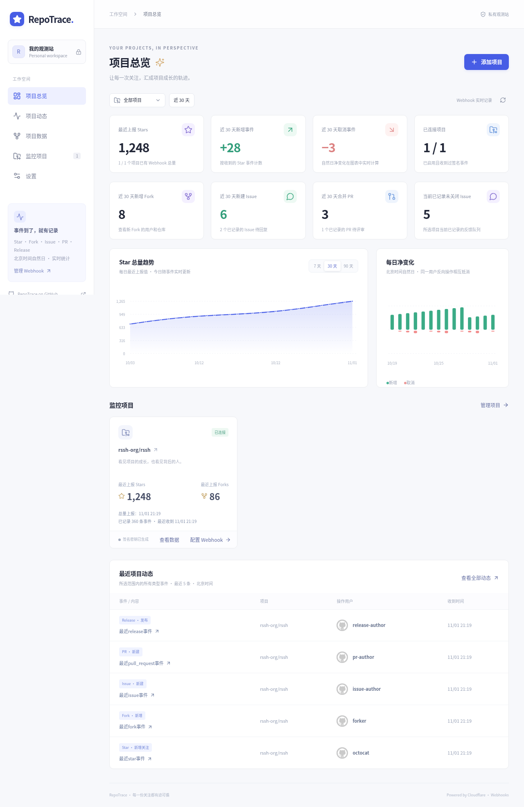
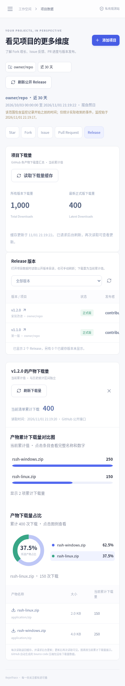

# RepoTrace ✦

个人 GitHub 项目观测站，基于 Cloudflare Workers + D1 + KV，无需自己的服务器。

## 支持的功能

- 首次访问设置管理员密码，登录后才能访问项目与统计。
- 多仓库监控，支持暂停、恢复和移除，兼容公开与私有仓库。
- **项目总览**：默认汇总所有项目的 Star、Fork、Issue 和 PR 统计，可下拉筛选单个项目，并展示最近 5 条各类型项目动态。
- **项目数据**：选择单个项目，分别查看 Star、Fork、Issue、PR、Release；Star 包含总量图、用户净变化和逐次事件名单。
- **时间筛选**：近 7 / 30 / 90 天，或两个 Release 发布时间之间；包含起始时刻，不包含结束时刻。
- **Issue / PR**：每日变化、标签与状态筛选、回复和评审情况、合并/关闭统计、耗时与已记录贡献者。
- **Release 列表**：按发布时间倒序显示最新 5 个，提示未显示的缓存版本数量，默认展开最新版本的产物下载量。
- **下载量**：所有版本及最新正式版的总量、按所选时间范围展示的总下载量增长图、各产物累计下载量、产物对比与占比图。Worker 每小时采集版本目录和下载总量，页面读取已保存的数据；产物明细按需刷新。
- 统一项目动态、Webhook 签名校验、重复投递去重，保留已有历史快照。

事件收到后即更新，事件图表按北京时间自然日统计。同一用户在区间内新增后又取消 Star，会在区间净变化中相互抵消。**项目数据**、Release 下拉和版本列表只读取已保存的目录，不触发 GitHub 查询。Release Webhook 只记录发版动态，不修改版本目录、产物、下载量或 Star / Fork 数字。

需要仓库的 Webhook 管理权限。事件统计仅覆盖启用后实际收到的数据，区间内的 Issue / PR 列表显示这些条目的当前已记录状态。Fork 只能可靠记录新增。

公开 Release 数据均经过 Worker，不需要 GitHub 访问凭据。Cloudflare Cron 每小时采集所有已启用项目，暂停项目不采集；首次无目录或下载量时等待下一轮采集。采集失败保留旧数据和最近成功采集时间，不补写历史点。GitHub 返回限流或拒绝访问时共享退避。打开产物明细时先返回缓存，再后台刷新该版本的产物数据；只有产物明细区域显示上游刷新错误。

Worker 从 GitHub 完整分页读取各 Release 的产物计数，汇总所有版本下载量，并单独查询最新正式版；目录和下载量全部读取成功后一起保存。增长图记录每次成功采集的累计总量，每项目每小时最多一个点，无法恢复启用前的下载历史。删除版本或产物可能使总量下降，失败时不会用旧值补点。GitHub 自动生成的 Source code 压缩包不提供下载量；私有仓库无法通过公开接口采集。

## 界面预览

以下截图使用演示数据。

**项目总览**：汇总各项目指标、Star 趋势和最近 5 条项目动态。



<details>
<summary>Release 与产物下载量（移动端）</summary>

查看版本列表、累计下载量，以及各产物的下载量对比和占比。



</details>

## 部署到 Cloudflare

### 1. Fork 仓库

打开 [shihuili1218/repotrace](https://github.com/shihuili1218/repotrace)，点击 **Fork**。

### 2. 在 Cloudflare 连接仓库

进入 **Workers & Pages → 创建应用 → 导入现有 Git 仓库 / 连接 GitHub**，选择自己 Fork 的 `repotrace`，使用 **Workers** 部署。

| 设置         | 填写内容                         |
| ------------ | -------------------------------- |
| 仓库         | 你的 GitHub 账号下的 `repotrace` |
| 生产分支     | `main`                           |
| 根目录       | `/`（仓库根目录）                |
| 构建命令     | `npm run build`                  |
| 部署命令     | `npx wrangler deploy`            |
| 构建环境变量 | `NODE_VERSION=24`                |

Cloudflare 自动创建并绑定 D1 数据库 `DB`、KV 命名空间 `WEBHOOK_KEYS`。表结构在首次运行时自动初始化；`wrangler.jsonc` 配置 `0 * * * *`，每小时触发一次 Release 目录与下载量采集。

### 3. 为项目连接 Webhook

1. 打开部署后的网页，设置管理员密码并登录，点击 **添加项目**，填写 `owner/repo` 或 GitHub 仓库地址。
2. 复制弹窗中的 **Payload URL** 和 **Secret**；每个项目有独立密钥，仅生成时显示一次。
3. 打开被监控仓库的 **Settings → Webhooks → Add webhook**。
4. 填入 **Payload URL**；**Content type** 选 `application/json`；**Secret** 填入刚复制的密钥，保留 **Enable SSL verification**。
5. 选择 **Let me select individual events**，按需要勾选：**Stars、Forks、Issues、Issue comments、Pull requests、Pull request reviews、Releases**。Releases 仅用于发版动态。勾选 **Active**，保存。
6. GitHub 会发送 Ping，RepoTrace 显示 **已连接** 后即可记录后续变化。弹窗也会显示哪些事件已收到；若未连接，检查 **Recent Deliveries** 的响应。

已有 Webhook 可直接编辑，增加勾选新事件，**原 Payload URL 和 Secret 继续使用**。只有更换签名密钥时才需要同步更新 GitHub Secret，并重新投递 Ping。无需创建 GitHub 访问凭据，也无需为项目配置 Cloudflare Secret。

### 保护首次初始化（可选）

首次成功设置密码的人会成为管理员。若需要保护初始化入口，请在第一次公开访问前，在 Worker 中添加随机机密 `SETUP_TOKEN` 并部署。初始化时必须输入这份口令。

### 后续更新

同步 Fork 的上游更新后，Cloudflare 可自动重新构建。保持同一 `DB` 和 `WEBHOOK_KEYS` 绑定，以保留密码、历史与签名密钥。首次部署后可将控制台中的资源 ID 固定到 Fork 的 `wrangler.jsonc`：D1 的 `database_id`、KV 的 `id`。

升级会保留管理员、项目、已收到的事件、产物数据和成功采集的下载量缓存，并启用每小时采集。下载量增长图从升级后的成功采集开始积累，既有历史汇总仍可查看。首次从旧的拉取版本升级的项目，请在 **配置 Webhook → 生成签名密钥** 完成连接。

## 命令行部署

需要 Node.js **24 LTS** 和 npm。将 `YOUR_GITHUB_USERNAME` 替换为自己的用户名：

```bash
git clone https://github.com/YOUR_GITHUB_USERNAME/repotrace.git
cd repotrace
npm ci
npx wrangler login
npm run deploy
```

部署后按上面的步骤连接 Webhook。若需要保护初始化，在首次访问前执行：

```bash
npx wrangler secret put SETUP_TOKEN
```

本地开发、测试及扩展说明见 [contributor.md](contributor.md)。
